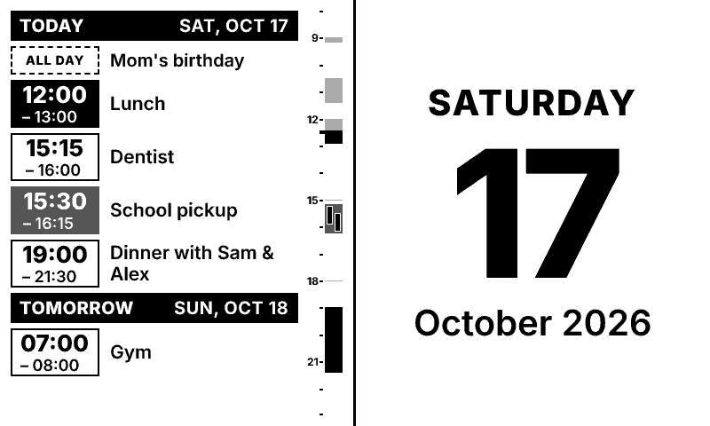

# trmnl-micah

One "meta plugin" for a TRMNL OG (800×480). It composes sub-plugins into a single
**greyscale PNG** (2-bit / 4 shades by default, 1-bit optional) and serves it over HTTP. TRMNL shows that PNG full-screen, so none of
TRMNL's Framework/markup is involved.



<sub>Demo data at 12:30: `npm run render -- --demo --now 2026-10-17T12:30`</sub>

```
Google Calendar (ICS) ─┐
other sources …       ─┼─▶ sub-plugins (JSX) ─▶ Satori → SVG ─▶ resvg → pixels ─▶ 2-bit (4-shade) greyscale PNG
                       ┘                                                       │
                                         GET /screen.png  and/or  POST every 5 min ──▶ TRMNL (Webhook Image)
```

## Quick start

```sh
npm install
cp .env.example .env      # paste your calendar's secret iCal URL
npm run dev               # → http://localhost:3000
```

The preview page shows the exact 1-bit image the device gets. It re-renders when
you save any file under `src/`. It also has toggles for demo data, 2× zoom, and a
"pretend now" time picker.

To render once to `out/screen.png`, run `npm run render` (add `-- --demo` to use sample data).

### Getting the Google Calendar URL

Google Calendar → ⚙ Settings → pick the calendar under "Settings for my calendars" →
**Integrate calendar** → **Secret address in iCal format**. Put it in `GCAL_ICS_URLS`
(comma-separate multiple calendars). Events you've declined are hidden. Your address is read from the feed, since Google names
primary calendars after their owner. For other calendars, set `GCAL_EMAIL`.

To hide events by title, set `HIDE_TITLES` in `.env` to a comma-separated list. Entries match
anywhere in the title, ignoring case, and `/pattern/flags` entries are regexes, e.g.
`HIDE_TITLES=Focus time,/^Hold:/`.

With no URL configured, the calendar shows demo data.

## Layout & sub-plugins

`src/config.ts` defines the screen as a row of slots, separated by a divider:

```ts
slots: [
  { plugin: "calendar", options: calendar },   // left half
  { plugin: "date" },                          // right half
]
```

`weight` changes the width split, e.g. `{ plugin: "calendar", weight: 2 }` for ⅔ width.

To add a sub-plugin, create `src/plugins/<name>/index.tsx` exporting a `Plugin`
(`load()` fetches data, `render()` returns JSX for exactly `size.width × size.height`),
then register it in `src/render.tsx`.

Satori gotchas:
- Every `<div>` with more than one child needs `display: "flex"`.
- Only flexbox layout is supported (no grid).
- Boxes are **content-box**: padding and borders add to `width`/`height`.
- Text is anti-aliased and then snapped to 4 shades (or 2 with `bitDepth: 1`).
  Keep text ≥ ~14px, and use weights 600+ for small or white-on-black text.
- Emoji and symbols Inter lacks (→, ✈, …) are drawn from monochrome Noto Emoji /
  Noto Sans Math glyphs (`src/glyphs.ts`). They are always black, so avoid them in
  white-on-black text.

## Deploying

### Docker (recommended)

```sh
git clone https://github.com/micahbf/trmnl-micah.git && cd trmnl-micah
cp .env.example .env   # set GCAL_ICS_URLS, TRMNL_WEBHOOK_URL, SCREEN_KEY, TZ_DISPLAY (containers are UTC)
docker compose up -d --build
```

This publishes the server on the host's `127.0.0.1:3000`. Point Caddy at it with the
snippet below. To update: `git pull && docker compose up -d --build`.

**Different port:** set `HOST_PORT` in `.env` (e.g. `HOST_PORT=8080`), run
`docker compose up -d`, and use `reverse_proxy 127.0.0.1:8080` in Caddy. Only the
host side changes; the container always listens on 3000, so leave `PORT` alone.

If Caddy itself runs in Docker, drop `ports:` and put both containers on a shared
network instead, then use `reverse_proxy trmnl:3000`.

### Without Docker (systemd)

Requires Node 22.2+.

```sh
git clone https://github.com/micahbf/trmnl-micah.git && cd trmnl-micah
npm ci --omit=dev
cp .env.example .env   # set GCAL_ICS_URLS, SCREEN_KEY, TZ_DISPLAY (servers are usually UTC)
npm start              # listens on 127.0.0.1:3000 (HOST/PORT to change)
```

`/etc/systemd/system/trmnl.service`:

```ini
[Unit]
Description=TRMNL screen renderer
After=network-online.target

[Service]
WorkingDirectory=/path/to/trmnl-micah
ExecStart=/usr/bin/npm start
Restart=always
User=youruser

[Install]
WantedBy=multi-user.target
```

Then run `sudo systemctl enable --now trmnl`. In the Caddyfile:

```
trmnl.example.com {
	reverse_proxy 127.0.0.1:3000
}
```

To update: `git pull && npm ci --omit=dev && sudo systemctl restart trmnl`.

## Hooking it up to TRMNL

### Webhook Image (recommended)

In TRMNL, add the **Webhook Image** plugin, save it, copy its Webhook URL into
`TRMNL_WEBHOOK_URL` in `.env`, and make the plugin the only item in your playlist. The
server then renders the screen every 5 minutes and POSTs it there (TRMNL allows 12
uploads per hour). Unchanged images aren't re-sent. The server doesn't need to be
reachable from the internet for this; the preview and `/screen.png` keep working.

The webhook URL works like a password: anyone with it can change your display.

### Alias (pull)

Alias only refreshes once a day, but it works if you'd rather TRMNL pull the image.
The server must be reachable from the internet. Point Alias at
`https://<your-host>/screen.png?key=<SCREEN_KEY>`. The endpoint sends `ETag` /
`Last-Modified` headers, so TRMNL only redraws when the image actually changes.
**Image Display** also works, but it rescales the image.

Set `SCREEN_KEY` before exposing the server, because the image contains your calendar.

### Bit depth

The output is already 800×480 greyscale. 2-bit (4-shade) images need device firmware
1.6.0+; set `bitDepth: 1` in config if yours shows garbage.
